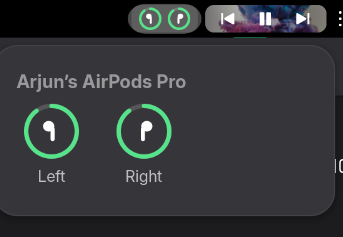

# Audio Battery for GNOME

A GNOME Shell extension that shows the battery of your AirPods, earbuds, headphones, headsets and speakers in the top bar, as rings around each device's icon, like the batteries widget on macOS.




- Rings sit together in a rounded pill that matches the [Now Playing](https://github.com/voidrlm/gnome-now-playing) pill, just left of it when that extension is installed
- Each ring fills with the battery level: green, yellow at 40% or below, red at 20% or below, green while charging
- Click to see each device with larger rings and labels
- Hidden when no audio device with a battery is connected
- Only audio devices are shown; mice, keyboards and the like are left out

## AirPods

AirPods don't report battery over standard Bluetooth, so the extension reads the battery broadcast they send to iPhones instead:

- Separate rings for the left bud, right bud and case
- Only what's actually reporting is shown: wear just the left AirPod and you get just a left earbud ring
- The case appears in the menu (in the top bar only when it's the only thing reporting)
- Levels come in steps of 10%

While Apple headphones are connected it keeps a low-energy Bluetooth scan running, so the rings update the moment you take a bud out or put it back. The scan stops as soon as they disconnect, and only broadcasts from the same model as your connected AirPods are used.

## Other earbuds, headphones and speakers

Any earbuds, headphones, headset or speaker that reports its battery to Linux (through UPower) gets its own ring, with the battery percentage shown in the menu.

Bluetooth calls almost everything with a microphone a "headset", so the extension works out the brand and type from the device's name instead, and draws a matching icon: earbuds, over-ear headphones, headset, neckband or speaker. It knows the model ranges of 59 brands (`brands.js`), for example:

- `SMOKIN' BUDS 360` → Skullcandy, earbuds
- Sony `WF-` earbuds, `WH-` headphones, `WI-` neckbands, `SRS-` speakers
- JBL Flip, Charge and Go speakers; JBL Tune 760NC headphones
- Galaxy Buds, Pixel Buds, AirPods Max, Beats Studio Pro, boAt Rockerz neckbands

Apple, Beats, Samsung, Sony, Bose, Jabra, Sennheiser, Skullcandy, JBL, Soundcore, Nothing, OnePlus, Google, Xiaomi, Huawei, Honor, OPPO, realme, vivo, Nokia, Motorola, LG, Marshall, Bang & Olufsen, Audio-Technica, Shure, AKG, Jaybird, Poly, Logitech, Razer, SteelSeries, HyperX, Corsair, Turtle Beach, Edifier, SoundPEATS, TOZO, QCY, EarFun, 1MORE, Haylou, Urbanista, Philips, Technics, Bowers & Wilkins, Master & Dynamic, boAt, Noise, boult, Mivi, Ultimate Ears, Tribit, Amazon, Fairphone, Moondrop, Denon, Audeze and Sudio.

Unknown brands are guessed from words in the name ("Buds", "TWS", "Speaker", "Neckband"), and the brand is shown above the device name in the menu.

Requires GNOME Shell 50.

<details><summary>Where it sits in the top bar</summary>


</details>

## Install

```bash
git clone https://github.com/voidrlm/gnome-audio-battery.git ~/.local/share/gnome-shell/extensions/audio-battery@arjun
```

Log out and back in, then enable it:

```bash
gnome-extensions enable audio-battery@arjun
```

## Update

```bash
git -C ~/.local/share/gnome-shell/extensions/audio-battery@arjun pull
```

Then log out and back in.
